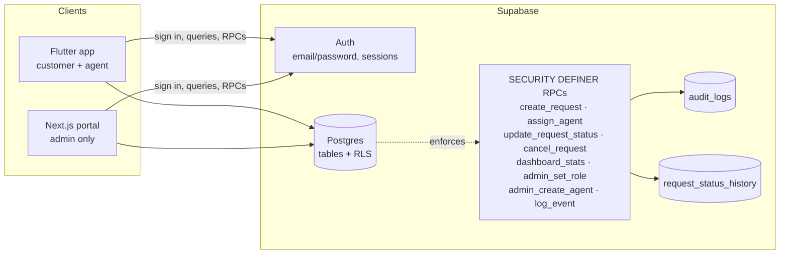

# QuickServe — Architecture

## Overview

Three tiers, one source of truth (Postgres). Both clients talk **directly** to
Supabase; there is no custom API server. All authorization therefore lives in
the database (RLS + `SECURITY DEFINER` RPCs), so a compromised client cannot
escalate privileges.

## Components

### Flutter app (`mobile/`)

| Layer | Responsibility |
|-------|----------------|
| `core/` | `AppConfig` (compile-time env), `ErrorMapper` (raw → friendly messages), `AppLogger` (redacted console + persisted events), theme |
| `domain/` | Pure models, enums, `Validators`, `StatusRules` (mirror of the DB transition table), `RequestId` formatting |
| `data/` | Repositories wrapping Supabase queries/RPCs — the only layer that touches the network |
| `state/` | Riverpod providers (auth state, profile, requests, services, summary) |
| `presentation/` | Screens, role-aware shell, shared widgets |

Routing uses `go_router` with an auth redirect: signed-out users are bounced to
`/login`, signed-in users away from public routes. The bottom-navigation shell
differs per role (customer: Home/Services/Requests/Profile, agent: Assigned/
History/Profile).

**Request flow (create):** form validation (pure `Validators`) → repository →
`create_request` RPC → row + initial history + `REQUEST_CREATED` audit written
in one transaction → provider invalidation → navigate to details.

### Next.js portal (`admin/`)

- `middleware.ts` refreshes the session and redirects non-admins to `/login`
  (UX only — RLS is the actual gate).
- Pages fetch through the browser/server Supabase client as the signed-in
  admin: `dashboard` (RPC stats), `requests` (search/filter/pagination/assign/
  status), `customers`, `agents` (role management), `audit`.
- `friendlyError()` renders safe messages; SQL/details never reach the UI.

### Supabase backend

1. **Auth** — email/password, persistent sessions, password reset.
2. **Postgres schema** — see [database.md](database.md).
3. **RLS** — see [security.md](security.md): row visibility and permitted
   writes are decided per row per role.
4. **RPCs** — `SECURITY DEFINER` functions that re-check role, validate input
   and enforce the state machine, then append history + audit rows.

## Key decisions

| Decision | Rationale |
|----------|-----------|
| Authorization in Postgres, not clients | Assignment requires backend-enforced RBAC; hiding buttons is insufficient |
| RPCs for every state change | Central place for transition rules, audit and history — no drift between clients |
| `request_id` generated by a DB trigger + sequence | Unique, gap-tolerant, forgery-proof ids (`REQ-2026-000123`) |
| Append-only history/audit tables | Triggers reject UPDATE/DELETE — audit trail integrity |
| Status history written by RPC, notes allowed without transition | Agents/customers can comment; history doubles as an activity feed |
| Env-based config (`env.json`, `.env.local`) | No secrets in git |

## Error handling strategy

1. Pure validators prevent bad input client-side.
2. Every repository call funnels through `ErrorMapper` / `friendlyError`.
3. Database errors arrive as `PostgrestException` with codes mapped to
   user-facing messages (`42501` → "not allowed", `22023` → validation, …).
4. Network loss is surfaced by `connectivity_plus` and mapped timeouts.
5. Denied attempts are *also* recorded as `AUTHORIZATION_FAILED` audit rows.

## Logging

`AppLogger.event()` persists whitelisted business events via the `log_event`
RPC. Console output is redacted (`password`, `token`, `secret`, `email`, …).
Passwords, tokens and API keys are never logged in either channel.
