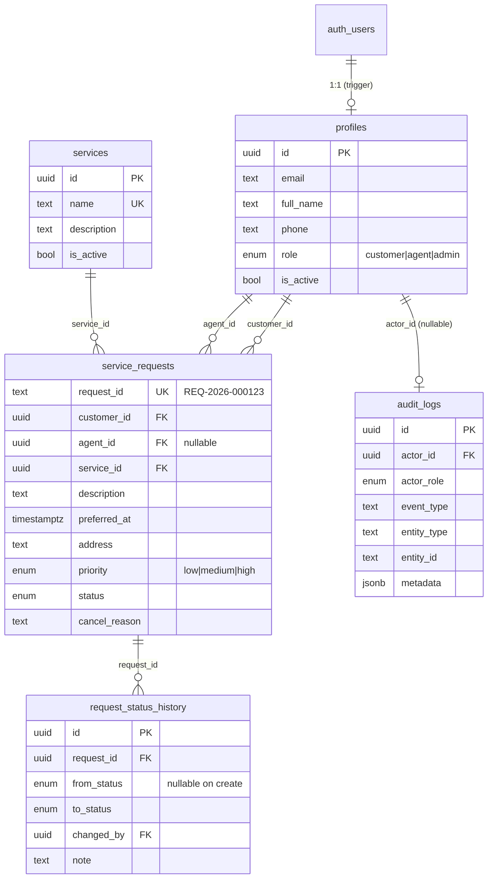

# QuickServe — Database Design

Postgres (Supabase). Migrations live in `supabase/migrations/` and are applied
in numerical order.

## ERD

## Tables

### `profiles` (1:1 with `auth.users`)
| Column | Type | Notes |
|--------|------|-------|
| `id` | uuid PK | references `auth.users(id) ON DELETE CASCADE` |
| `email` | text | from auth |
| `full_name` | text | required, default from email local-part |
| `phone` | text | optional, 10-digit format validated client-side |
| `role` | enum | `customer` (default) / `agent` / `admin` |
| `is_active` | bool | soft-disable switch |

Auto-created by the `on_auth_user_created` trigger on `auth.users` — signup can
only ever produce a `customer`; roles are promoted by `admin_set_role()`.

### `services`
`name` is unique; seeded with AC Servicing, Plumbing, Electrical, Cleaning.

### `service_requests`
| Column | Type | Notes |
|--------|------|-------|
| `request_id` | text UK | `REQ-{YYYY}-{6-digit}`, from trigger + `request_id_seq` |
| `customer_id` | uuid FK | NOT NULL, restrict on delete |
| `agent_id` | uuid FK | nullable until assigned, set-null on delete |
| `service_id` | uuid FK | NOT NULL |
| `description` | text | CHECK 10–2000 chars |
| `preferred_at` | timestamptz | validated future-ish in RPC |
| `address` | text | CHECK 5–500 chars |
| `priority` | enum | `low` / `medium` / `high` |
| `status` | enum | `created → assigned → accepted → in_progress → completed`, plus `cancelled` |

**Status transition table** (enforced by `is_valid_transition()` and re-checked
in `update_request_status()` / `cancel_request()`):

| From | Allowed to |
|------|-----------|
| created | assigned, cancelled |
| assigned | accepted, cancelled |
| accepted | in_progress, cancelled |
| in_progress | completed, cancelled |
| completed, cancelled | *(terminal)* |

### `request_status_history` (append-only)
One row per transition + rows for notes (`from_status = to_status`).
A `BEFORE UPDATE OR DELETE` trigger raises on mutation — history is immutable.

### `audit_logs` (append-only)
`actor_id`, `actor_role`, whitelisted `event_type`, `entity_type`,
`entity_id`, `metadata jsonb`, `created_at`. Same append-only trigger.
**Never stores passwords, tokens, API keys or emails.**

## Indexes

| Table | Index | Why |
|-------|-------|-----|
| `service_requests` | `(customer_id, created_at DESC)` | "My requests" listing |
| `service_requests` | `(agent_id, status)` | agent work queue |
| `service_requests` | `(status, created_at DESC)` | admin dashboard filters |
| `service_requests` | `(service_id)` | FK lookups |
| `service_requests` | `request_id` UNIQUE | human-facing id |
| `request_status_history` | `(request_id, created_at)` | detail timelines |
| `audit_logs` | `(created_at DESC)`, `(actor_id, created_at DESC)`, `(entity_id)`, `(event_type, created_at DESC)` | portal filters |
| `profiles` | `(role)` | agent/customer pickers |

## Constraints

- Enums restrict every state column to known values.
- CHECK lengths on description/address.
- FKs: `customer_id` restrict (never orphan a request), `agent_id` set-null.
- `updated_at` maintained by trigger; `request_id` assigned by trigger.

## Transactions

RPCs run in a single transaction: validate → update → append history → append
audit. A failure anywhere rolls the whole change back, so history can never
diverge from the request row.
